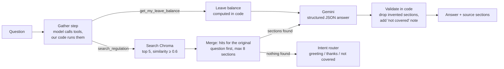

# HR Assistant: RAG over a Company Regulation

An assistant that answers employee questions from a Turkish HR regulation, citing the exact sections it used, and saying so when the regulation does not cover a question.

```
POST /ask  {"question": "Karım doğum yaptı, ikimiz ne kadar izin alabiliriz?"}

{
  "answer": "Eşinizin doğum yapması halinde size üç gün mazeret izni verilir. Eşiniz ise doğumdan önce sekiz hafta ve sonra sekiz hafta doğum izni kullanabilir. Ayrıca isteği halinde altı aya kadar ücretsiz izin alabilir ve çocuğu bir yaşına gelinceye kadar günde bir buçuk saat süt izni kullanabilir.",
  "sections": ["5.7.5.1.1", "5.7.5.1", "5.7.8.3"],
  "refused": false,
  "missing_info": [],
  "missing_info_note": null,
  "tools_used": ["search_regulation: doğum izni", "search_regulation: babalık izni", "search_regulation: süt izni"],
  "sources": [
    {"section": "5.7.5.1.1", "page": 8, "path": "5. … > 5.7.5. Mazeret izni > 5.7.5.1. Doğum İzni",
     "text": "5.7.5.1.1. Evlenmesi veya eşinin doğum yapması halinde üç gün,"},
    …
  ],
  "model": "gemini-flash-lite-latest"
}
```

Every answer lists the regulation sections it is based on, with their text in `sources`. On the chat page, clicking a section opens its text, so the answer can be checked against the document.

## How it works



**Indexing:** the PDF is split by regulation section (`5.7.5.1.1`, …) instead of fixed-size chunks. Each section is stored with its heading path (`İzinler > Mazeret izni > …`) so short items like "üç gün" keep their meaning.

**Gathering with tool calling:** the model gets two tools and up to 4 turns to collect facts before anything is answered. With `search_regulation` it splits a question into separate searches ("my wife is pregnant and also works here" becomes maternity leave, paternity leave, nursing leave). The search for the employee's own wording always runs and keeps its results, so tool calling can add sections but never push out the ones a plain search would find. Tools are executed by our code, not by the SDK.

**Employee leave balance:** with an employee signed in, `get_my_leave_balance` returns years of service, entitled, used and remaining days. The tool takes no arguments: the employee comes from the session, so the model cannot request another person's record. Entitlement is calculated in code from the seniority table in section 5.7.4, never by the model, and the answer cites the matching rule. Employee data in `data/employees.json` is synthetic and stands in for an HR system.

**Answering:** the model fills a typed schema (`can_answer`, `answer`, `used_sections`, `missing_info`). Decisions that must be reliable (refusal message, source list, "not covered" note) are made in code, not left to the prompt.

**Chat page:** `/` serves a single page in plain HTML, CSS and JavaScript (no build step), with a demo employee selector, clickable source sections, a separate note for parts the regulation does not cover, and the searches the model made. Text from the server is always inserted as text, never as HTML. It uses system fonts, so the page makes no requests outside the server. The regulation PDF opens inside the page at the cited section's page (in a new tab on phones).

**Failures:** quota, server and "model not found" errors are retried with fallback to the next model; bad requests and invalid keys fail immediately. Blocked or unparseable model output is reported as an error instead of a half-answer. The API returns 503 in all these cases, and `/health` returns 503 until the document has been indexed.

## Design decisions

| Problem found | Decision |
|---|---|
| Fixed 800-character chunks split rules and lost context | Section-based chunks with the heading path prepended |
| The source PDF was OCR'd, with ~700 broken words (`Yönetmeli ğin`) | Cleaned with a word-frequency based joining script before indexing |
| The regulation's numbering puts some leave types under a misleading heading | Path and section text are shown to the model separately; the prompt says to trust the text |
| Free-text "Bu konuda bilgim yok" detection was fragile and broke partial answers | Structured output; refusal and partial coverage are explicit fields |
| The model sometimes cited sections it was not given | Cited sections are filtered against the retrieved ones |
| Same question, different answers | `temperature=0` |
| Fixing each failing test with a special prompt line made the system worse | Prompt rewritten as general rules; regressions caught by the evaluation set |
| Free tier limits (429) and busy models (503) | Retry with backoff, model fallback, rate-limited and idempotent indexing |

## Evaluation

`python -m hr_assistant.evaluate` runs a question set with known answers and checks three things separately:

- **Citation recall:** does the answer cite the expected sections? This measures the sections the answer is based on, not everything retrieval returned.
- **Answer:** does it contain the expected facts, and none of the forbidden ones (e.g. a child's marriage when asked about one's own)?
- **Honesty:** for questions the regulation does not cover, does it refuse or clearly flag the gap instead of inventing an answer? Mixed questions (leave days plus a severance calculation) must answer the covered part and flag the rest.

Keyword checks are Turkish-aware: `İ/ı` casing, suffixes (`2 aydır` matches `2 ay`), and section numbers are excluded so `5.7.5.1.3` does not count as "3". Leave balance cases use a fixed date so their expected numbers do not change over time.

Last full run, before the leave balance cases and the "flag the uncovered part" check were added: **10/10 answers correct, 100% citation recall.** The set is small and was used during development, so it is a regression guard rather than a measure of general accuracy.

Unit tests (`pytest`) cover the parts that do not need the model: leave calculation and seniority boundaries, keyword matching, chunking, and retry/fallback behaviour with a fake client.

## Run it

Requires Python 3.12 and a [Gemini API key](https://aistudio.google.com).

```bash
python -m venv .venv
.venv\Scripts\activate          # macOS/Linux: source .venv/bin/activate
pip install -r requirements.txt
copy .env.example .env          # then put your key in .env
```

Place the regulation PDF at `documents/hr_regulation.pdf`, then:

```bash
python -m hr_assistant.ingest      # index the document (safe to re-run)
python -m hr_assistant.ask         # chat in the terminal
python -m hr_assistant.ask --employee E1002   # signed in as a demo employee
python -m hr_assistant.evaluate    # run the evaluation set
uvicorn hr_assistant.api:app       # chat page at http://127.0.0.1:8000, API docs at /docs
```

API endpoints: `POST /ask` with an optional `employee_id`, `GET /employees` lists the demo employees, `GET /document` returns the regulation PDF, `GET /health`. In this demo the employee id comes in the request body; a real deployment would take it from the authenticated session.

The `/ask` response has the answer, the cited `sections` and their text in `sources`, the parts the regulation does not cover in `missing_info`, the tools the model used, and in `model` the model that wrote the answer (`null` for fixed replies such as greetings). The "not covered" sentence is part of `answer`, so a client that only shows `answer` never hides it; `missing_info_note` holds the same sentence for clients that show it separately.

Unit tests: `pip install -r requirements-dev.txt`, then `pytest`.

With Docker: `docker compose up --build`, then run the ingest step once inside the container (`docker compose exec api python -m hr_assistant.ingest`). The container runs as a non-root user (uid 1000); on Linux the mounted `chroma_db` folder must be writable by that user.

The Docker image installs from `requirements.lock` (exact versions with hashes, wheels only). After changing `requirements.txt`, regenerate it with `pip install uv`, then:
`uv pip compile requirements.txt --python-version 3.12 --python-platform x86_64-manylinux_2_28 --generate-hashes -o requirements.lock`

## Project structure

```
hr_assistant/
├── config.py      settings and paths
├── llm.py         Gemini client: embeddings, structured generation, retry, fallback
├── retrieval.py   Chroma vector store and search
├── ingest.py      PDF → sections → embeddings → Chroma
├── tools.py       tool calling: regulation search and leave balance
├── employees.py   demo employee records and leave calculation
├── answer.py      prompt, structured answer, intent routing
├── api.py         FastAPI: chat page at /, POST /ask, GET /employees, GET /document, GET /health
├── ask.py         terminal chat
├── static/        chat page (index.html, style.css, app.js)
└── evaluate.py    evaluation runner
data/employees.json   synthetic demo employees
eval/test_cases.json
tests/                unit tests
```

## About the data

The regulation is a publicly available document. The PDF and its prebuilt index (`chroma_db/`) are in the repository, so the app starts without running ingest. Any regulation numbered by section (`1.`, `1.1.`, `1.1.1.`) works with the same pipeline. Employee data (`data/employees.json`) is synthetic.

The seniority table in `employees.py` is copied from section 5.7.4 of that document (14 days up to 5 years, 20 days up to 15 years, 24 days after). It is not the Turkish Labour Law: the law gives 26 days from 15 years on and puts exactly 15 years in the top tier. Whether exactly 5 and 15 years belong to the lower or upper tier must be checked against the regulation's wording, and the table must be updated when a different regulation is used.

## Next steps

- Conversation memory, so follow-up questions ("and for my wife?") keep their context
- Tune the similarity threshold from measured scores and add hybrid (keyword + semantic) search
- A held-out question set that is not used for tuning
- Stable chunk ids so a changed regulation re-indexes cleanly (together with support for a second document)
