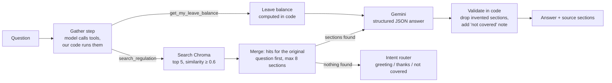

# HR Assistant: RAG over a Company Regulation

An assistant that answers employee questions from a Turkish HR regulation, citing the exact sections it used, and saying so when the regulation does not cover a question.

**Live demo:** https://hr-rag-assistant-f6kz.onrender.com/ (free hosting: the first request after a quiet period can take up to a minute)

## How it works



**Indexing:** the PDF is split by regulation section (`5.7.5.1.1`, …) instead of fixed-size chunks. Each section is stored with its heading path (`İzinler > Mazeret izni > …`) so short items like "üç gün" keep their meaning.

**Gathering with tool calling:** the model gets two tools and up to 4 turns to collect facts before anything is answered. With `search_regulation` it splits a question into separate searches ("my wife is pregnant and also works here" becomes maternity leave, paternity leave, nursing leave). The search for the employee's own wording always runs and keeps its results, so tool calling can add sections but never push out the ones a plain search would find. Tools are executed by our code, not by the SDK.

**Employee leave balance:** with an employee signed in, `get_my_leave_balance` returns years of service, entitled, used and remaining days. The tool takes no arguments: the employee comes from the session, so the model cannot request another person's record. Entitlement is calculated in code from the seniority table in section 5.7.4, never by the model, and the answer cites the matching rule.

**Answering:** the model fills a typed schema (`can_answer`, `answer`, `used_sections`, `missing_info`). Decisions that must be reliable (refusal message, source list, "not covered" note) are made in code, not left to the prompt.

**Chat page:** plain HTML, CSS and JavaScript, no build step. Each cited section opens its text, and the regulation PDF opens at that section's page, so every answer can be checked against the document.

**Failures:** quota, server and "model not found" errors are retried with fallback to the next model; bad requests and invalid keys fail immediately. Blocked or unparseable output is reported as an error instead of a half-answer. The public demo is limited to 20 questions per hour per client and 200 in total.

## Key decisions

- Section-based chunks instead of fixed 800-character chunks, which split rules and lost context.
- The OCR'd PDF had ~700 broken words (`Yönetmeli ğin`); they are joined by a word-frequency script before indexing.
- Structured output instead of detecting "Bu konuda bilgim yok" in free text; cited sections are filtered against the retrieved ones.
- The prompt is written as general rules, not one fix per failing test; an evaluation set catches regressions.

## Evaluation

`python -m hr_assistant.evaluate` checks citation recall, expected and forbidden facts, and honesty on questions the regulation does not cover. Last full run: **10/10 correct, 100% citation recall** (a small set used during development, so a regression guard rather than an accuracy claim). `pytest` covers what does not need the model.

## Run it

Requires Python 3.12 and a [Gemini API key](https://aistudio.google.com). The regulation PDF and its prebuilt index are in the repository.

```bash
python -m venv .venv
.venv\Scripts\activate          # macOS/Linux: source .venv/bin/activate
pip install -r requirements.txt
copy .env.example .env          # then put your key in .env
uvicorn hr_assistant.api:app    # chat page at http://127.0.0.1:8000, API docs at /docs
```

Or `docker compose up --build`. Terminal chat: `python -m hr_assistant.ask --employee E1002`. Employee data is synthetic.

The Docker image installs from `requirements.lock`. After changing `requirements.txt`, regenerate it with `uv pip compile requirements.txt --python-version 3.12 --python-platform x86_64-manylinux_2_28 --generate-hashes -o requirements.lock`.
