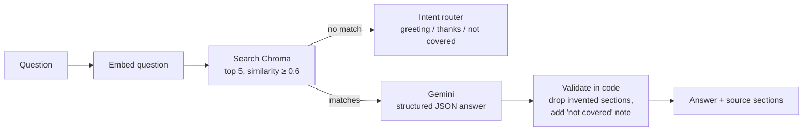

# HR Assistant: RAG over a Company Regulation

An assistant that answers employee questions from a Turkish HR regulation, citing the exact sections it used, and saying so when the regulation does not cover a question.

```
POST /ask  {"question": "Karım doğum yaptı, ikimiz ne kadar izin alabiliriz?"}

{
  "answer": "Eşinizin doğum yapması halinde size üç gün mazeret izni verilir. Eşiniz ise doğumdan önce sekiz hafta ve sonra sekiz hafta doğum izni kullanabilir. Ayrıca isteği halinde altı aya kadar ücretsiz izin alabilir ve çocuğu bir yaşına gelinceye kadar günde bir buçuk saat süt izni kullanabilir.",
  "sections": ["5.7.5.1.1", "5.7.5.1", "5.7.8.3"],
  "refused": false,
  "missing_info": []
}
```

## How it works



**Indexing:** the PDF is split by regulation section (`5.7.5.1.1`, …) instead of fixed-size chunks. Each section is stored with its heading path (`İzinler > Mazeret izni > …`) so short items like "üç gün" keep their meaning.

**Answering:** the model fills a typed schema (`can_answer`, `answer`, `used_sections`, `missing_info`). Decisions that must be reliable (refusal message, source list, "not covered" note) are made in code, not left to the prompt.

## Design decisions

| Problem found | Decision |
|---|---|
| Fixed 800-character chunks split rules and lost context | Section-based chunks with the heading path prepended |
| The source PDF was OCR'd, with ~700 broken words (`Yönetmeli ğin`) | Cleaned with a word-frequency based joining script before indexing |
| The regulation's numbering puts some leave types under a misleading heading | Path and section text are shown to the model separately; the prompt says to trust the text |
| Free-text "Bu konuda bilgim yok" detection was fragile and broke partial answers | Structured output; refusal and partial coverage are explicit fields |
| The model sometimes cited sections it was not given | Cited sections are filtered against the retrieved ones |
| Same question, different answers | `temperature=0` |
| Fixing each failing test with a special prompt line made the system worse | Prompt rewritten as general rules; regressions caught by the evaluation set |
| Free tier limits (429) and busy models (503) | Retry with backoff, model fallback, rate-limited and idempotent indexing |

## Evaluation

`python -m hr_assistant.evaluate` runs a question set with known answers and checks three things separately:

- **Retrieval:** were the expected sections actually used?
- **Answer:** does it contain the expected facts, and none of the forbidden ones (e.g. a child's marriage when asked about one's own)?
- **Honesty:** for questions the regulation does not cover, does it refuse or clearly flag the gap instead of inventing an answer?

Keyword checks are Turkish-aware: `İ/ı` casing, suffixes (`2 aydır` matches `2 ay`), and section numbers are excluded so `5.7.5.1.3` does not count as "3".

Current result: **10/10 answers correct, 100% retrieval recall.** The set is small and was used during development, so it is a regression guard rather than a measure of general accuracy.

## Run it

Requires Python 3.12 and a [Gemini API key](https://aistudio.google.com).

```bash
python -m venv .venv
.venv\Scripts\activate          # macOS/Linux: source .venv/bin/activate
pip install -r requirements.txt
copy .env.example .env          # then put your key in .env
```

Place the regulation PDF at `documents/hr_regulation.pdf`, then:

```bash
python -m hr_assistant.ingest      # index the document (safe to re-run)
python -m hr_assistant.ask         # chat in the terminal
python -m hr_assistant.evaluate    # run the evaluation set
uvicorn hr_assistant.api:app       # API with docs at http://127.0.0.1:8000/docs
```

## Project structure

```
hr_assistant/
├── config.py      settings and paths
├── llm.py         Gemini client: embeddings, structured generation, retry, fallback
├── retrieval.py   Chroma vector store and search
├── ingest.py      PDF → sections → embeddings → Chroma
├── answer.py      prompt, structured answer, intent routing
├── api.py         FastAPI: POST /ask, GET /health
├── ask.py         terminal chat
└── evaluate.py    evaluation runner
eval/test_cases.json
```

## About the data

The regulation used during development is a third-party sample document and is not included in the repository. Any regulation numbered by section (`1.`, `1.1.`, `1.1.1.`) works with the same pipeline.

## Next steps

- Tune the similarity threshold from measured scores and add hybrid (keyword + semantic) search
- A held-out question set that is not used for tuning
- Docker setup
- Tool calling, e.g. checking an employee's remaining leave balance
